# Laboratorio de redes — POO + Flask + React

Aplicación full-stack para la **Actividad 2 (Programación Orientada a Objetos en Python)**, contextualizada en **conceptos básicos de redes**: inventario y diagnóstico de equipos de un laboratorio campus (**routers** y **switches**).

El backend aplica encapsulamiento, herencia, polimorfismo y excepciones personalizadas; el frontend React consume una API REST Flask para operaciones del día a día; `main.py` ofrece un **menú de consola** y un banco de **pruebas POO** alineado al enunciado académico.

---

## Tabla de contenidos

- [Visión general](#visión-general)
- [Arquitectura del sistema](#arquitectura-del-sistema)
- [Estructura del repositorio](#estructura-del-repositorio)
- [Modelo de dominio (POO)](#modelo-de-dominio-poo)
  - [Jerarquía de herencia en los modelos](#jerarquía-de-herencia-en-los-modelos)
- [Flujo de datos (API)](#flujo-de-datos-api)
- [Frontend React](#frontend-react)
- [Módulos backend y responsabilidades](#módulos-backend-y-responsabilidades)
- [Requisitos](#requisitos)
- [Instalación y ejecución](#instalación-y-ejecución)
- [API REST — referencia](#api-rest--referencia)
- [Variables de entorno](#variables-de-entorno)
- [Conceptos POO vs. enunciado](#conceptos-poo-vs-enunciado)
- [Solución de problemas](#solución-de-problemas)

---

## Visión general

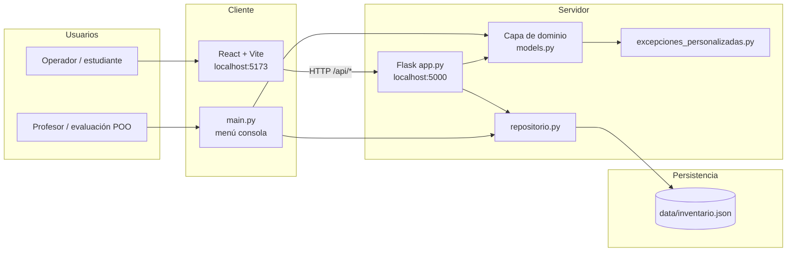

| Capa | Tecnología | Rol |
|------|------------|-----|
| Presentación web | React 18, Vite | Formularios, tabla de inventario, panel de diagnósticos |
| Presentación consola | `main.py` | Menú CRUD + demostración de `try/except/else/finally` |
| API | Flask 3, Flask-CORS | JSON REST sobre el mismo dominio de objetos |
| Dominio | Python POO | `DispositivoRed`, `Router`, `Switch`, `RegistroLaboratorio` |
| Persistencia | JSON en disco | Inventario durable entre reinicios |

---

## Arquitectura del sistema

### Capas y separación de responsabilidades

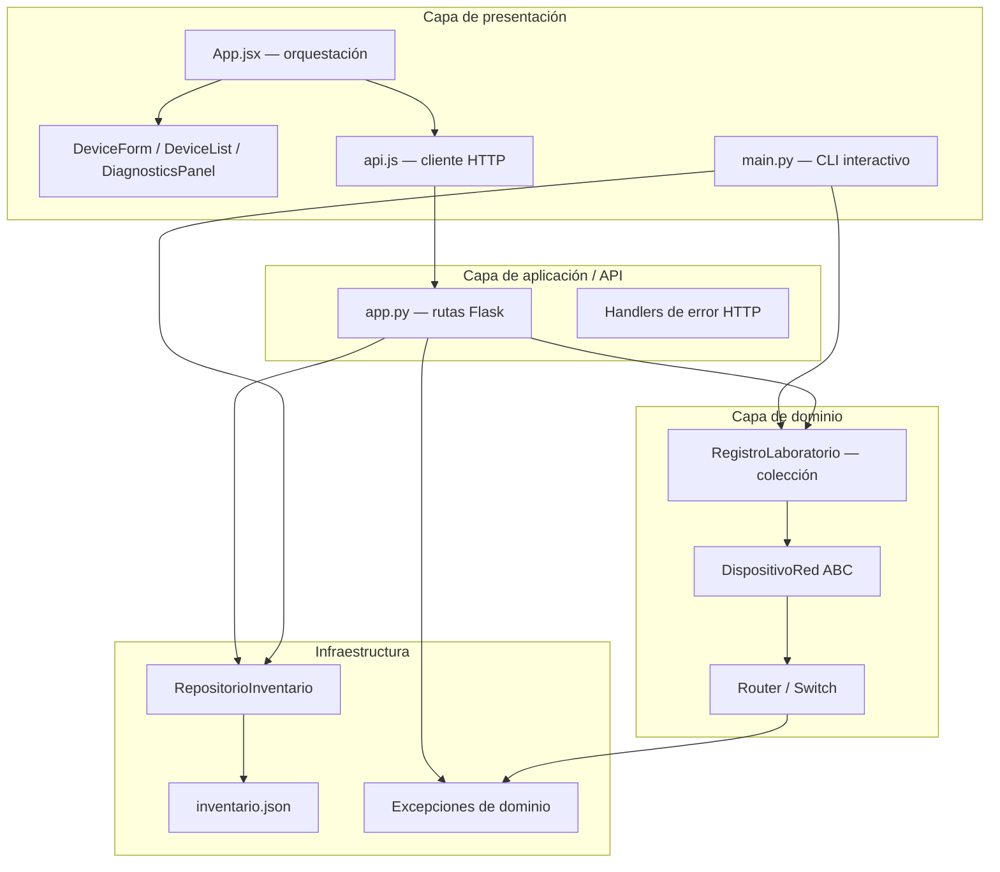

**Principio:** la lógica de negocio vive en `models.py`; `app.py` solo adapta HTTP ↔ objetos; `repositorio.py` solo serializa; la UI no duplica validaciones críticas (IP, estados, rangos numéricos) porque el servidor las aplica en los setters.

### Puertos y proxy en desarrollo

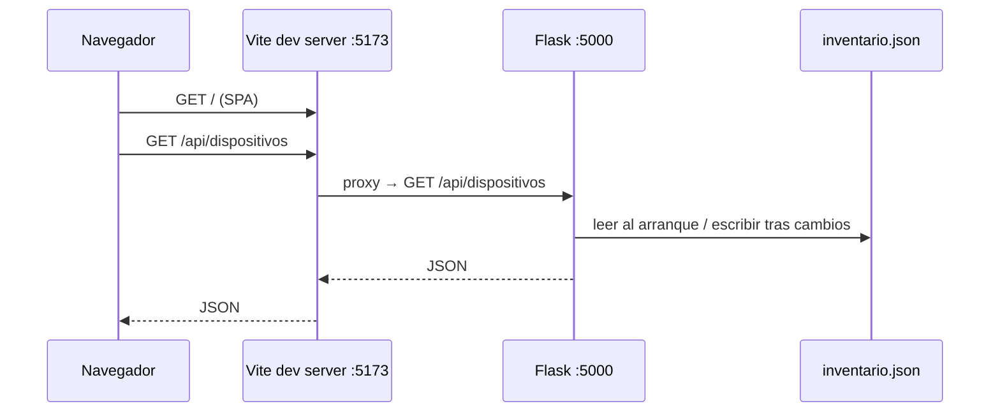

La configuración del proxy está en `frontend/vite.config.js` (`/api` → `http://127.0.0.1:5000`).

---

## Estructura del repositorio

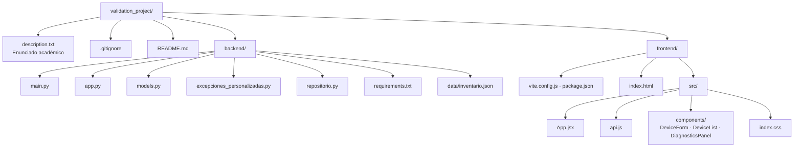

### Árbol de archivos (fuente)

```
validation_project/
├── description.txt
├── README.md
├── .gitignore
├── backend/
│   ├── main.py
│   ├── app.py
│   ├── models.py
│   ├── excepciones_personalizadas.py
│   ├── repositorio.py
│   ├── requirements.txt
│   └── data/
│       └── inventario.json          # generado al usar la app
└── frontend/
    ├── index.html
    ├── package.json
    ├── vite.config.js
    └── src/
        ├── main.jsx
        ├── App.jsx
        ├── api.js
        ├── index.css
        └── components/
            ├── DeviceForm.jsx
            ├── DeviceList.jsx
            └── DiagnosticsPanel.jsx
```

---

## Modelo de dominio (POO)

### Jerarquía de herencia en los modelos

En `models.py`, la herencia se centra en **un único árbol**: la clase abstracta `DispositivoRed` define el contrato común del campus; las subclases concretas especializan atributos y **sobrescriben** los métodos abstractos. `RegistroLaboratorio` **no hereda** de `DispositivoRed`: agrega una relación de **composición** (colección de dispositivos polimórficos).

#### Árbol de herencia (vista vertical)

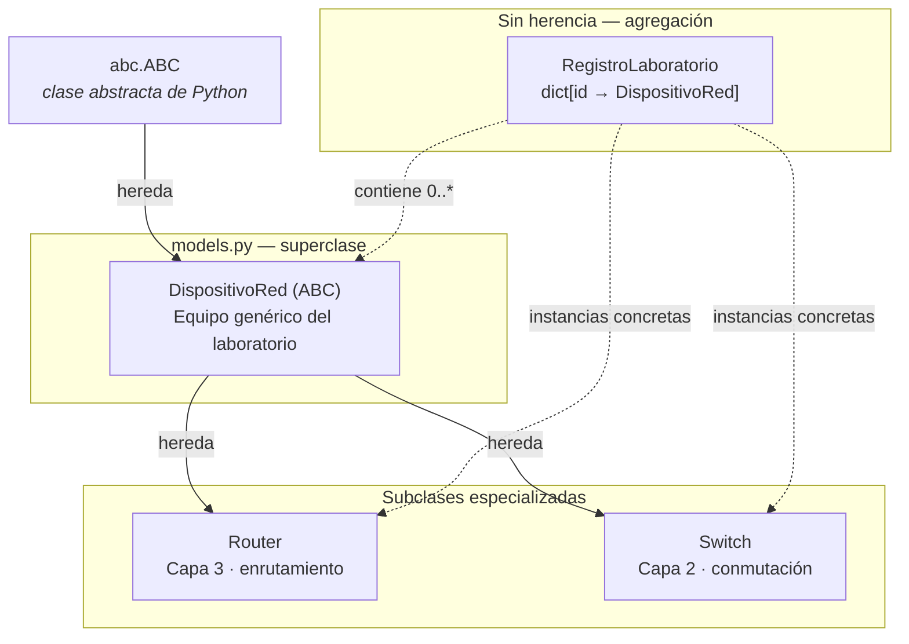

#### Jerarquía UML (herencia y contrato abstracto)

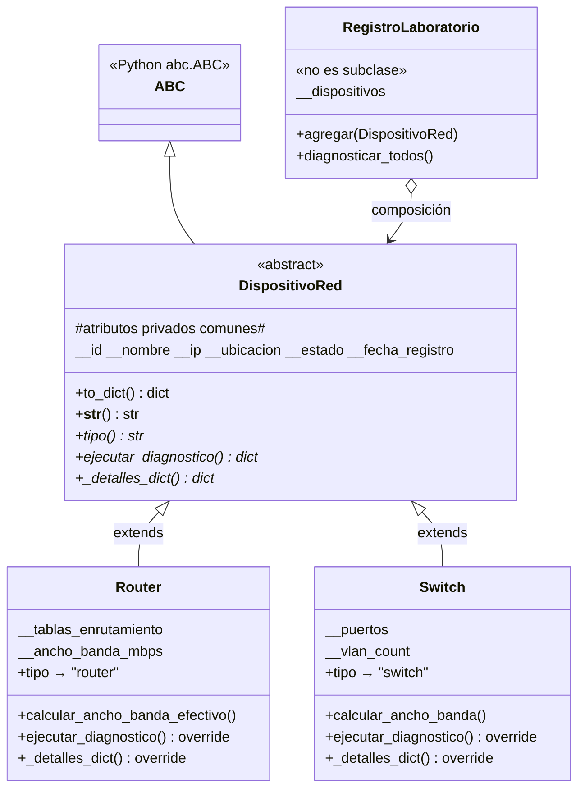

**Leyenda:** métodos marcados con **override** implementan el contrato abstracto de la base; el resto del comportamiento común (validación de IP, estados, `to_dict`, etc.) se **hereda** sin reescribir.

| Elemento | Hereda de | Qué aporta |
|----------|-----------|------------|
| `DispositivoRed` | `ABC` | Plantilla de equipo: encapsulamiento, propiedades validadas, métodos abstractos |
| `Router` | `DispositivoRed` | `tablas_enrutamiento`, `ancho_banda_mbps`, diagnóstico tipo *traceroute_simulado* |
| `Switch` | `DispositivoRed` | `puertos`, `vlan_count`, diagnóstico tipo *tabla_mac_simulada* |
| `RegistroLaboratorio` | — | Gestiona muchos `DispositivoRed` vía polimorfismo (lista/CRUD/diagnóstico masivo) |

#### Qué hereda cada subclase vs. qué sobrescribe

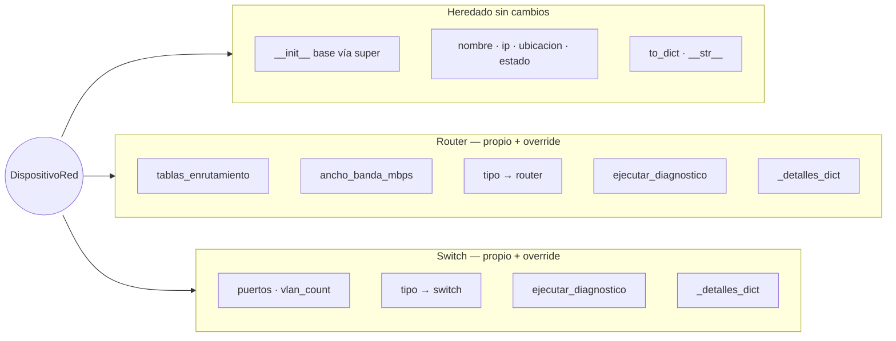

Referencia en código: definiciones en [`backend/models.py`](backend/models.py) — líneas `DispositivoRed` (~28), `Router` (~131), `Switch` (~218), `RegistroLaboratorio` (~310).

---

### Diagrama de clases

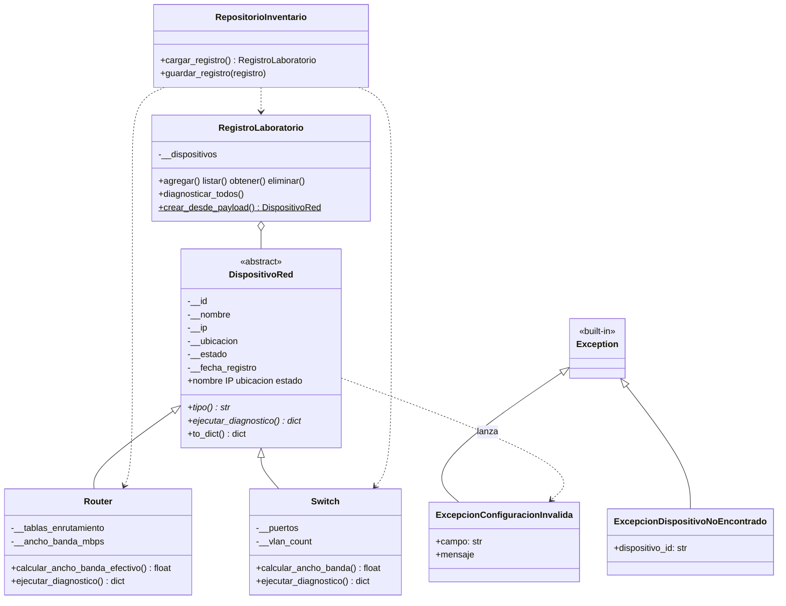

### Polimorfismo en diagnóstico

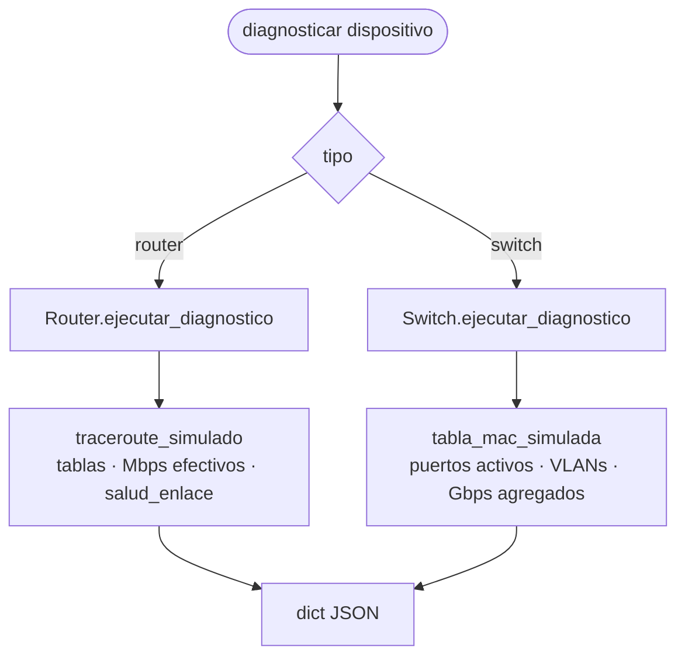

Ambas subclases responden al **mismo mensaje** (`ejecutar_diagnostico()`), con **comportamiento distinto** — requisito explícito del enunciado.

---

## Flujo de datos (API)

### Crear un dispositivo desde la UI

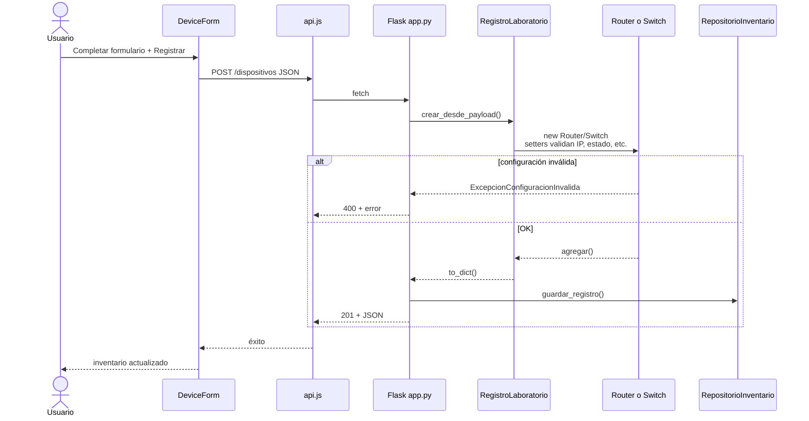

### Punto de entrada dual (web vs consola)

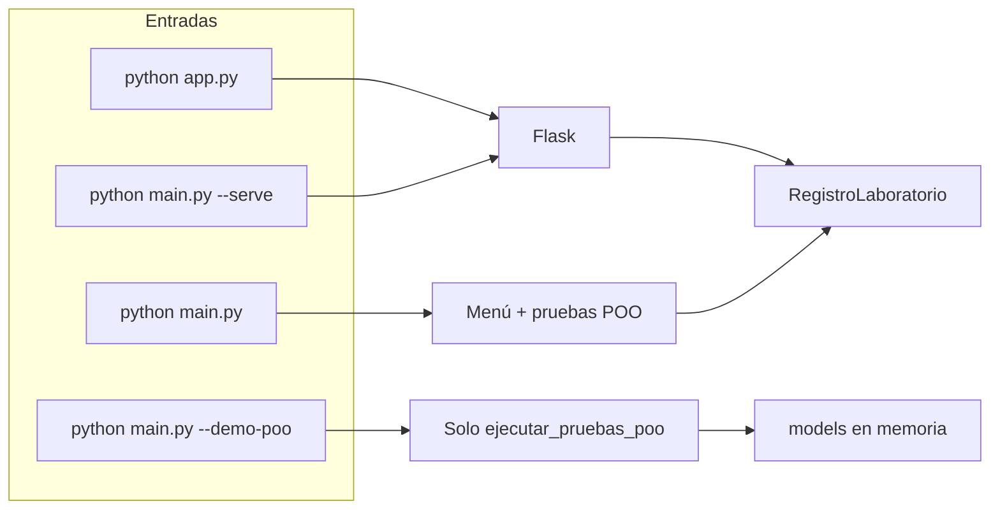

---

## Frontend React

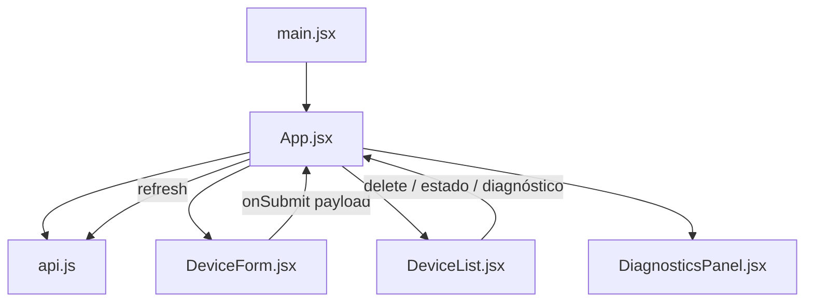

| Componente | Función |
|------------|---------|
| `App.jsx` | Estado global, salud de API, errores, orquestación |
| `api.js` | Cliente `fetch` hacia `/api/*` |
| `DeviceForm.jsx` | Alta dinámica según `tipo` (router vs switch) |
| `DeviceList.jsx` | Tabla, selector de estado, acciones por fila |
| `DiagnosticsPanel.jsx` | Muestra JSON de diagnósticos (polimorfismo visible) |

---

## Módulos backend y responsabilidades

| Archivo | Responsabilidad | Relación con el enunciado |
|---------|-----------------|---------------------------|
| `models.py` | Entidades, validación encapsulada, polimorfismo | Clases base/hijas, `@property`, `ejecutar_diagnostico()` |
| `excepciones_personalizadas.py` | Errores de dominio tipados | `ExcepcionConfiguracionInvalida(Exception)` |
| `main.py` | Inicialización, menú, `ejecutar_pruebas_poo()` | Archivo principal + pruebas `try/except/else/finally` |
| `app.py` | REST JSON, CORS, mapeo HTTP ↔ excepciones | Capa API (extensión del proyecto práctico) |
| `repositorio.py` | Carga/guardado de inventario | Persistencia fuera del dominio |

---

## Requisitos

| Herramienta | Versión mínima |
|-------------|----------------|
| Python | 3.10+ (probado con 3.14 vía `py -3`) |
| Node.js | 18+ |
| npm | Incluido con Node |

---

## Instalación y ejecución

### 1. Backend (API) — terminal 1

```powershell
cd backend
py -3 -m venv .venv
.\.venv\Scripts\Activate.ps1
pip install -r requirements.txt
py -3 app.py
```

Servicio: **http://127.0.0.1:5000**  
Comprueba: `GET http://127.0.0.1:5000/api/health`

> En Windows, si `python` no está en PATH, usa el lanzador **`py -3`** en lugar de `python`.

### 2. Frontend — terminal 2

```powershell
cd frontend
npm install
npm run dev
```

Abre **http://localhost:5173**. Usa **«Cargar datos demo»** para poblar el inventario sin escribir a mano.

### 3. Consola académica (entrega POO)

```powershell
cd backend
.\.venv\Scripts\Activate.ps1
py -3 main.py              # menú interactivo + pruebas al inicio
py -3 main.py --demo-poo   # solo bloque de demostración POO
py -3 main.py --serve      # alternativa: Flask desde main
```

### Build de producción (frontend)

```powershell
cd frontend
npm run build
npm run preview
```

---

## API REST — referencia

| Método | Ruta | Descripción |
|--------|------|-------------|
| `GET` | `/api/health` | Estado del servicio y conteo de dispositivos |
| `GET` | `/api/dispositivos` | Lista el inventario |
| `POST` | `/api/dispositivos` | Crea router o switch (`tipo` en JSON) |
| `GET` | `/api/dispositivos/<id>` | Detalle por UUID |
| `DELETE` | `/api/dispositivos/<id>` | Elimina |
| `PATCH` | `/api/dispositivos/<id>/estado` | Body: `{ "estado": "activo" \| ... }` |
| `POST` | `/api/dispositivos/<id>/diagnostico` | Diagnóstico polimórfico de uno |
| `POST` | `/api/diagnosticos/ejecutar-todos` | Diagnóstico de todos |
| `POST` | `/api/demo/semilla` | Datos de ejemplo (si el inventario está vacío) |

### Ejemplo de cuerpo — crear router

```json
{
  "tipo": "router",
  "nombre": "R-Core-Lab",
  "ip": "10.0.0.1",
  "ubicacion": "Edificio A - Rack 1",
  "estado": "activo",
  "tablas_enrutamiento": 12,
  "ancho_banda_mbps": 10000
}
```

### Ejemplo de cuerpo — crear switch

```json
{
  "tipo": "switch",
  "nombre": "SW-Planta-2",
  "ip": "10.0.2.10",
  "ubicacion": "Edificio B",
  "puertos": 48,
  "vlan_count": 6
}
```

---

## Variables de entorno

| Variable | Por defecto | Uso |
|----------|-------------|-----|
| `PORT` | `5000` | Puerto de Flask |
| `FLASK_DEBUG` | `0` | `1` activa debug en `app.py` |
| `CORS_ORIGIN` | `*` | Origen permitido para CORS |

---

## Conceptos POO vs. enunciado

| Requisito del enunciado | Implementación |
|-------------------------|----------------|
| Modularidad (`main`, `models`, excepciones) | Tres módulos + `app.py` / `repositorio.py` auxiliares |
| Superclase de entidad campus | `DispositivoRed` (ABC) |
| Encapsulamiento `__attr` + `@property` | IP, estado, nombre, puertos, etc. |
| Dos subclases | `Router`, `Switch` |
| Polimorfismo (override) | `ejecutar_diagnostico()`, métodos de ancho de banda |
| Excepción personalizada | `ExcepcionConfiguracionInvalida` |
| try/except/else/finally | `main.py` (`ejecutar_pruebas_poo`, menú), `app.py` (rutas POST/PATCH) |

---

## Solución de problemas

| Síntoma | Causa probable | Qué hacer |
|---------|----------------|-----------|
| UI: «API desconectada» | Flask no está en ejecución | Levantar `py -3 app.py` en `backend/` |
| `Python was not found` | Alias de Windows / PATH | Usar `py -3` o activar `.venv` |
| Error 400 al crear equipo | IP inválida o VLANs > puertos | Revisar mensaje en `error` del JSON |
| Inventario vacío tras reinicio | Sin permisos en `data/` | Verificar que `backend/data/inventario.json` se cree al guardar |

---

## Licencia y contexto académico

Proyecto educativo para diseño topológico y gestión de equipos de red en un escenario campus. El código fuente está pensado para revisión de **POO en Python** y, en paralelo, como demo de integración **Flask + React**.
